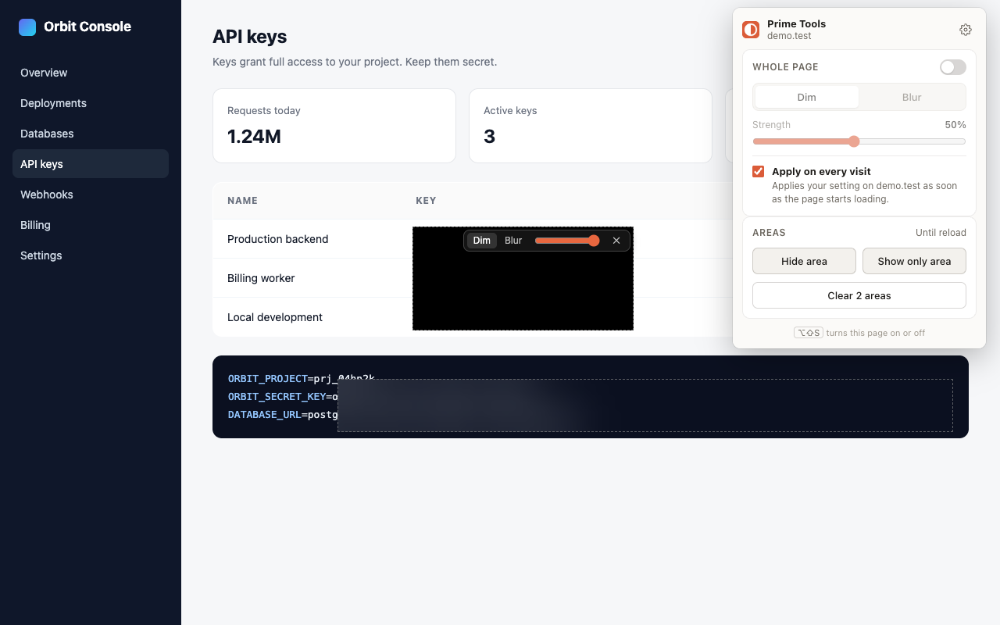

# Prime Tools

> Dim, blur or hide any part of a web page. Remembers per site. Local-only, open source.

[](https://github.com/prime0x2/prime-tools/actions/workflows/ci.yml)



Prime Tools is a small Chrome and Firefox extension for the moments a page shows more than you want it to: screen-sharing a dashboard with keys on it, streaming with your inbox open, or reading a blinding white page at night.

- **Whole page:** dim or blur the entire page at any strength, remembered per site.
- **Apply on every visit:** opt in per site and the effect is applied as soon as the page starts loading.
- **Hide an area:** drag over anything to cover it. The cover scrolls with the page.
- **Show only an area:** drag over what you want to keep; everything else is covered.
- **Stays on top:** overlays sit in the browser's top layer, above modal dialogs, popovers and fullscreen elements.
- **Keyboard first:** `Alt+Shift+D` opens the popup, `Alt+Shift+S` toggles the current site.
- **Private by design:** no accounts, no analytics, no network requests. Private windows never save anything.

## Install

- **Chrome Web Store:** _link after approval_
- **Firefox Add-ons:** _link after approval_

### Unpacked (before store approval)

1. Download `prime-tools-<version>-chrome.zip` (or `-firefox.zip`) from the latest release and unzip it somewhere permanent.
2. **Chrome:** open `chrome://extensions`, turn on **Developer mode**, click **Load unpacked**, and pick the unzipped folder.
   **Firefox:** open `about:debugging#/runtime/this-firefox`, click **Load Temporary Add-on…**, and pick `manifest.json`. Temporary add-ons are removed when Firefox restarts.
3. Pin the toolbar icon.

## How it works

| Feature | Saved? | Permission |
|---|---|---|
| Whole-page dim/blur | Per site (`origin`, port included) | `activeTab` when you open the popup |
| Apply on every visit | Per host | Optional host permission for that one site, requested when you tick the box |
| Hide / show only an area | Never; gone on reload | `activeTab` |
| Private windows | Never saved; affects that tab only | `activeTab` |

The page script is injected on demand with `scripting.executeScript`. For sites you opted into, the background registers it with `scripting.registerContentScripts` at `document_start`, scoped to exactly the hosts you granted. Settings live in `storage.local` as one key per site (`site:<origin>`), so concurrent writers can't clobber each other.

The overlays are manual [popovers](https://developer.mozilla.org/docs/Web/API/Popover_API). Whenever the page puts something new into the top layer (a modal `<dialog>`, a popover, fullscreen), they're re-shown so they stay above it. Area controls live in a closed shadow root, so page CSS and scripts can't reach them.

### Known limits

- **Blur is visual, not security.** A blurred area hides content on screen and in screen shares, but the text is still in the page: copy/paste, DevTools and the page's own scripts can see it. Use Dim at 100% for an opaque cover.
- Areas are pinned to page coordinates. Content that scrolls inside its own panel (not the whole page) can move out from under an area.
- Browsers block all extensions on their own pages (`chrome://`, `about:`), on extension stores and in the built-in PDF viewer.
- Auto-apply on a host covers every port on it (match patterns can't carry a port), while the saved effect is per port.
- Auto-apply reads your setting asynchronously as the page starts loading. On a very fast page, the first frame can paint before the effect does.
- While a site's own modal dialog is open you can still draw new areas over it, but the toolbars of existing areas can't be clicked until it closes. That's how browsers make everything outside a modal inert.
- Areas are drawn with a mouse, pen or touch; there's no keyboard way to draw one yet.

## Develop

Requires Node 22 (`.nvmrc`) and pnpm.

```sh
pnpm install
pnpm dev            # Chrome with live reload
pnpm dev:firefox    # Firefox with live reload
```

## Quality

```sh
pnpm compile        # TypeScript
pnpm lint           # Biome (lint + format)
pnpm test           # Vitest unit tests (WXT fake browser + happy-dom)
pnpm test:e2e       # Playwright: loads the built extension into Chromium
pnpm test:e2e:firefox  # puppeteer-core over WebDriver BiDi, real Firefox
pnpm lint:firefox   # addons-linter, the same checks AMO runs
pnpm verify         # everything except e2e
```

`test:e2e:firefox` finds Firefox, Developer Edition or Nightly in `/Applications`; set `FIREFOX_BIN` to point elsewhere.

The E2E suite builds a special variant (`WXT_E2E=1`, output in `.output/chrome-mv3-e2e`) that has blanket host access, so tests can exercise auto-apply without a native permission prompt. It checks rendered pixels: that dimmed pages are actually dark, areas actually cover their region and scroll with the page, and the overlay stays above a modal dialog.

## Build and release

```sh
pnpm build          # .output/chrome-mv3
pnpm build:firefox  # .output/firefox-mv3
pnpm zip:all        # store zips + sources zip (for AMO review)
pnpm build:store    # store screenshots + promo tiles → docs/store/
```

To bump the version, change `version` in `package.json`. WXT writes it into both manifests. Then update `CHANGELOG.md`.

### Building from source (for AMO reviewers)

```sh
nvm use             # Node 22
corepack enable     # pnpm 10, as pinned in package.json
pnpm install --frozen-lockfile
pnpm build:firefox  # output: .output/firefox-mv3
```

## Manual QA before a release

Run in a fresh profile on both browsers:

1. Open any article → popup → turn on **Whole page**; switch Dim/Blur; drag strength. The page follows live.
2. Tick **Apply on every visit**, accept the prompt, reload. The effect appears as the page starts loading. The toolbar badge shows **ON**.
3. Open the same site in a second tab. It follows changes made in the first.
4. **Hide area**: drag a box, scroll; it stays on the content. Hover it to change mode/strength or remove it.
5. **Show only area**: drag; everything else is covered. Press `Esc` during a selection to cancel.
6. Open a modal dialog or fullscreen a video on a dimmed page. It stays dimmed.
7. Press `Alt+Shift+S` on a page: it toggles on/off.
8. Private window: changes apply to that tab only; **Settings → Remembered sites** doesn't list it.
9. Settings: sites listed with their effect; **Forget** removes the site and its auto-apply permission.
10. `chrome://extensions`, the Chrome Web Store, `about:addons`: the popup explains it can't work there.

## Privacy

See [PRIVACY.md](./PRIVACY.md). Short version: nothing leaves your device.

## License

[MIT](./LICENSE)
